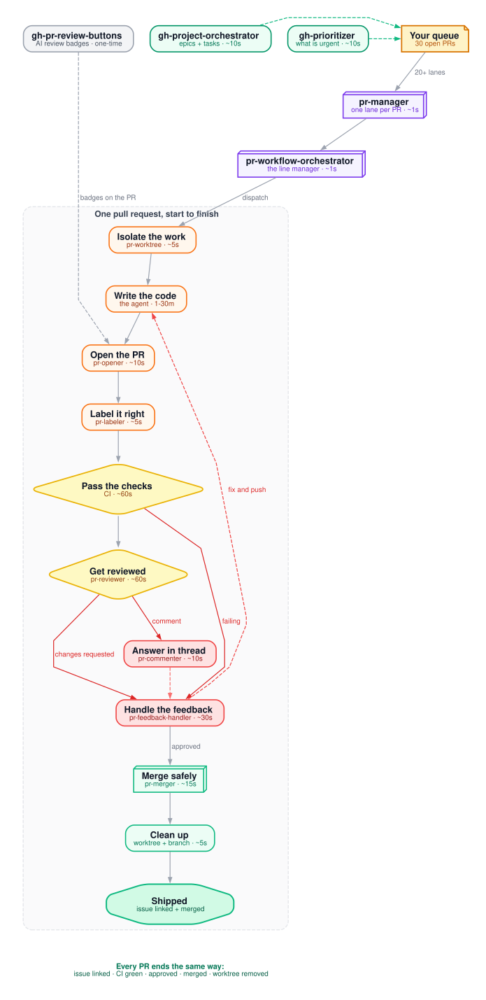

# gh-skills — the autonomous PR brain for AI coding agents

[](LICENSE)
[](skills)
[](https://agentskills.io/specification)
[](https://skills.sh/odykyi/gh-skills)
[](https://skills.sh/odykyi/gh-skills)
[](https://github.com/odykyi/gh-skills)
[](https://github.com/odykyi/gh-skills/fork)
[](https://github.com/odykyi/gh-skills/commits/main)

**GitHub automation skills for AI coding agents** — the full pull request lifecycle, labelling, projects, and issue-to-PR flow.

Every skill is a self-contained folder with a `SKILL.md` (plus optional `references/` loaded on demand) and follows the standard Anthropic skill format.

---

## Install in one click

<table align="center">
  <tr>
    <td align="center" valign="middle"><a href="claude://code/new?q=Install%20the%20GitHub%20PR%20automation%20skills%20from%20https%3A%2F%2Fgithub.com%2Fodykyi%2Fgh-skills%20into%20this%20project%20and%20walk%20me%20through%20the%20setup%20step%20by%20step."></a></td>
    <td align="center" valign="middle"><a href="cursor://anysphere.cursor-deeplink/prompt?text=Install%20the%20GitHub%20PR%20automation%20skills%20from%20https%3A%2F%2Fgithub.com%2Fodykyi%2Fgh-skills%20into%20this%20project%20and%20walk%20me%20through%20the%20setup%20step%20by%20step."></a></td>
    <td align="center" valign="middle"><a href="codex://new?prompt=Install%20the%20GitHub%20PR%20automation%20skills%20from%20https%3A%2F%2Fgithub.com%2Fodykyi%2Fgh-skills%20into%20this%20project%20and%20walk%20me%20through%20the%20setup%20step%20by%20step."></a></td>
    <td align="center" valign="middle"><a href="https://claude.ai/new?q=Install%20the%20GitHub%20PR%20automation%20skills%20from%20https%3A%2F%2Fgithub.com%2Fodykyi%2Fgh-skills%20into%20this%20project%20and%20walk%20me%20through%20the%20setup%20step%20by%20step."></a></td>
    <td align="center" valign="middle"><a href="https://chatgpt.com/?q=Install%20the%20GitHub%20PR%20automation%20skills%20from%20https%3A%2F%2Fgithub.com%2Fodykyi%2Fgh-skills%20into%20this%20project%20and%20walk%20me%20through%20the%20setup%20step%20by%20step."></a></td>
    <td align="center" valign="middle"><a href="#install"></a></td>
  </tr>
</table>

Not installing? You can also [star it, fork it, take a single skill, or host your
own marketplace](#use-it-your-way).

### Ask an AI about this repo

<table align="center">
  <tr>
    <td align="center" valign="middle"><a href="https://grok.com/?q=Read%20the%20README%20at%20https%3A%2F%2Fgithub.com%2Fodykyi%2Fgh-skills%20and%20explain%20how%20to%20install%20and%20use%20these%20GitHub%20PR%20automation%20skills%20as%20a%20maintainer%20who%20has%20dozens%20of%20open%20pull%20requests."></a></td>
    <td align="center" valign="middle"><a href="https://claude.ai/new?q=Read%20the%20README%20at%20https%3A%2F%2Fgithub.com%2Fodykyi%2Fgh-skills%20and%20explain%20how%20to%20install%20and%20use%20these%20GitHub%20PR%20automation%20skills%20as%20a%20maintainer%20who%20has%20dozens%20of%20open%20pull%20requests."></a></td>
    <td align="center" valign="middle"><a href="https://chatgpt.com/?q=Read%20the%20README%20at%20https%3A%2F%2Fgithub.com%2Fodykyi%2Fgh-skills%20and%20explain%20how%20to%20install%20and%20use%20these%20GitHub%20PR%20automation%20skills%20as%20a%20maintainer%20who%20has%20dozens%20of%20open%20pull%20requests."></a></td>
    <td align="center" valign="middle"><a href="codex://new?prompt=Read%20the%20README%20at%20https%3A%2F%2Fgithub.com%2Fodykyi%2Fgh-skills%20and%20explain%20how%20to%20install%20and%20use%20these%20GitHub%20PR%20automation%20skills%20as%20a%20maintainer%20who%20has%20dozens%20of%20open%20pull%20requests."></a></td>
  </tr>
</table>

---

## This is the autonomous brain for GitHub maintainers

A maintainer with an active repo — think a project like [OpenClaw](https://github.com/odykyi/openclaw) or any fast-moving OSS project — does not have a "write some code" problem. The problem is **the queue**: 30 open PRs, 4 reviewers who never respond, CI that flickers, a branch that drifted, a contributor who left three review comments unanswered, a release branch waiting on two of them.

That queue is a loop, and loops are exactly what agents are good at. `gh-skills` encodes that loop as a set of verifiable procedures:

**Read the queue → open the PR → review it → fix the feedback → merge it → clean up → next.**

Nothing is invented at each step. Every command is a real `gh`/`git` invocation, every gate is a checkable condition, and every destructive action has a guardrail. The agent never force-pushes, never merges with `--admin`, never deletes a branch that isn't merged, and never opens a PR without a linked issue.

Think of it as the PR half of an autonomous maintainer: you give it the repo and the backlog, it keeps the queue moving while you do the thinking only a human can do.

### Who this is for

| | |
|---|---|
| ✅ **Great for** | Maintainers juggling **dozens of PRs** at once |
| ✅ **Great for** | Repos where every PR needs an issue, a label, a review, and a clean merge |
| ✅ **Great for** | Anyone who wants CI to gate merges, and an agent to never let a PR rot |
| ❌ **Not for** | Contributors with **one or two PRs** — just open the PR, this is overkill |
| ❌ **Not for** | Quick one-off edits — the whole point is queue discipline, and you don't have a queue |

If you have **unlimited AI tokens and you like running loops and many subagents**, this is exactly the shape of tool you want: one subagent per PR, each in its own git worktree, all of them reporting back to a single orchestrator that never loses a PR.

If you have a budget of three API calls a day, keep it simple — this repo is for the other kind of day.

---

## The factory line

A pull request is a production line. `pr-workflow-orchestrator` is the line
manager, every skill is a station, and the numbers below are how long a
station usually takes.

<details>
<summary><strong>Show the skill-by-skill call map</strong> (animated)</summary>

<p align="center">
  
</p>

</details>

`pr-manager` runs the same line once per PR, in parallel — 20+ lanes at a time.

<details>
<summary><strong>Show the PR lifecycle flow</strong> (animated)</summary>

<p align="center">
  
</p>

</details>

The lifecycle starts at `main` (top), fans out into one subagent per task (the
three parallel columns, each in its own worktree), converges on a shared
monitoring loop, and cycles back: **changes requested → fix → push → re-review**,
and **failing CI → fix → push → re-review**. Only a merged PR closes the loop.

- Sources: [`assets/skill-calls.dot`](./assets/skill-calls.dot) and [`assets/pr-lifecycle.dot`](./assets/pr-lifecycle.dot) (Graphviz)
- Rebuild: `./assets/build-diagram.sh` (needs `graphviz`)

---

## Use cases

**You have stuck PRs.** Twenty PRs open, nobody reviewing, three of them
rotting for a week. Point the agent at the queue and let it run the line:
every PR gets picked up, classified, reviewed, and either fixed or answered.
Nothing waits for you to notice it.

```
@pr-workflow-orchestrator Handle feedback for PR #277, #281 and #294.
Pick up each one, fix what is real, reply to what is not, and report what
you could not close and why.
```

**A contributor went quiet mid-review.** Three comments unanswered, branch
drifted, CI red. `pr-feedback-handler` classifies each comment as *fix* or
*reply*, never guesses at intent, and re-runs the checks.

**You are on holiday and the queue must not stop.** The orchestrator keeps
watching: it monitors every 3 minutes, answers reviews, and merges what is
approved and green. The Definition of Done is explicit — issue linked **and**
PR merged — so nothing is quietly left open.

**Twenty tasks need to land this week.** `pr-manager` gives each one its own
worktree and its own subagent, then aggregates the results into one summary.
No two tasks share a working directory, so they cannot collide.

**Your labels are a mess.** `pr-labeler` re-labels the queue by branch name,
changed files and diff size, and reports what it found missing — with a
`--dry-run` first, so nothing changes until you say so.

**Your project board is fiction.** `gh-prioritizer` scores every item —
missing issue link first, then age, category, size and blockers — and tells
you which PR is actually the most urgent.

**You want AI reviews on every PR.** `gh-pr-review-buttons` adds
"Review this PR in Grok / Claude / Codex" badges to every PR description. One
script, one workflow, no API key, nothing running in CI that shouldn't be.

**You are onboarding a new maintainer.** Point them at `rules/AGENTS.github.md`
— the drop-in rules that tell the agent how *your* repository does pull
requests, so the skills do not have to guess your conventions.


---

## Make your agent genuinely good at GitHub

Without these skills an agent writes code and then guesses at the boring half of the job: it forgets to link the issue, opens a PR with an empty body, misses a reviewer comment, merges with red CI, deletes the wrong branch, and leaves six worktrees behind. Each one of those is a cheap mistake with an expensive follow-up.

With them, the agent stops improvising the workflow and starts running a verified one:

- **Nothing gets opened without an issue.** `pr-opener` enforces the link in both directions, so a PR can never be an orphan.
- **Reviews land where reviewers can act.** `pr-reviewer` and `pr-commenter` post real line-anchored review comments, not wall-of-text top-level comments.
- **Feedback loops close.** `pr-feedback-handler` classifies every incoming comment as *fix* or *reply* and never guesses at an unclear request — it asks instead.
- **Merges are safe by default.** `pr-merger` checks approval, CI, and mergeability before merging, then cleans up the worktree and branch. No `--admin`, no force push, no `-D`.
- **Work is isolated.** `pr-worktree` gives every task its own git worktree, so parallel work never collides and your main checkout is never disturbed.
- **Scale is boring.** `pr-manager` drives 20+ concurrent PRs through parallel subagents with one Definition of Done: issue linked **and** merged.
- **The board stays honest.** `gh-prioritizer` and `gh-project-orchestrator` keep priorities and project state aligned with reality.

In short: these skills turn "the agent touched GitHub" into "the agent ran the workflow correctly" — the same way you'd hand a colleague the runbook instead of a vague instruction.

---

## Skills

| Skill | What it does |
|-------|--------------|
| [pr-workflow-orchestrator](./skills/pr-workflow-orchestrator/SKILL.md) | End-to-end PR workflow: worktree → open → feedback → merge. Never leaves a PR unattended. |
| [pr-manager](./skills/pr-manager/SKILL.md) | Orchestrates 20+ PRs in parallel with strict Definition of Done enforcement. |
| [pr-worktree](./skills/pr-worktree/SKILL.md) | Creates and manages isolated git worktrees for PR work — never touches the main checkout. |
| [pr-opener](./skills/pr-opener/SKILL.md) | Opens PRs with correct formatting, description, and mandatory linked issue. |
| [pr-reviewer](./skills/pr-reviewer/SKILL.md) | Comprehensive code review posted as structured review comments. |
| [pr-feedback-handler](./skills/pr-feedback-handler/SKILL.md) | Handles incoming PR comments — fixes the issue or replies with the reason. |
| [pr-commenter](./skills/pr-commenter/SKILL.md) | Posts PR comments: general, line-level, and thread replies. |
| [pr-labeler](./skills/pr-labeler/SKILL.md) | Auto-labels PRs by branch name, changed files, size, and type. |
| [pr-merger](./skills/pr-merger/SKILL.md) | Merges approved PRs safely — conflicts, CI checks, post-merge cleanup. |
| [gh-pr-review-buttons](./skills/gh-pr-review-buttons/SKILL.md) | Adds "Review this PR in" Grok / Claude / Codex badges to PR descriptions. |
| [gh-project-orchestrator](./skills/gh-project-orchestrator/SKILL.md) | Creates and manages GitHub Projects (v2), linking epics, issues, and PRs. |
| [gh-prioritizer](./skills/gh-prioritizer/SKILL.md) | Auto-sets priorities across project items, audits the board, syncs issue/PR priority. |

---

## Install

**Claude Code plugin** — this repository is a plugin marketplace:

```
/plugin marketplace add odykyi/gh-skills
/plugin install gh-skills@gh-skills
```

**skills CLI** — installs into whichever agent it detects:

```bash
npx skills add odykyi/gh-skills
```

**Any agent** — symlink the skills into an agent directory:

```bash
curl -fsSL https://raw.githubusercontent.com/odykyi/gh-skills/main/install.sh | sh -s -- --agent claude --project
```

`install.sh` supports `--agent claude|codex|opencode|cursor|agents` and
`--global|--project`. It only creates symlinks, never copies markdown, never
uses `sudo`, and cleans up its own stale links on re-run.

**Manual**:

```bash
git clone --depth 1 https://github.com/odykyi/gh-skills.git /tmp/gh-skills
cp -R /tmp/gh-skills/skills/* ~/.claude/skills/
```

Which agent looks where: [`docs/agents.md`](./docs/agents.md).
Something not working: [`docs/troubleshooting.md`](./docs/troubleshooting.md).

## Prerequisites

- `gh` CLI authenticated (`gh auth status`)
- Repository write access for anything that creates, labels, comments on, or merges PRs
- `git` 2.17+ (for `git worktree remove`, `lock`, `unlock`)

## Repository layout

```
skills/          the skills — source of truth
rules/           drop-in AGENTS.md for repos that use these skills
template/        template for a new skill
docs/            creating skills, agent support, troubleshooting
assets/          the animated flow diagram (Graphviz source + SVG)
scripts/         the linter CI runs
install.sh       symlink installer for any agent
llms.txt         machine-readable index
SPEC.md          the contract this collection makes
AGENTS.md        rules for agents contributing to this repo
```

`skills/` is the single source of truth. The plugin, the `npx skills` package
and the `.agents/skills` symlinks all point at it — nothing is duplicated.

Every push runs `node scripts/validate-skills.mjs`, which checks the
frontmatter of every skill, that `name` matches the folder, that every
`references/` link resolves, that no banned or broken command has crept back
in, and that the README, `llms.txt` and the marketplace manifest all agree on
the skill list.


---

## Usage

Skills trigger on intent, e.g.:

- "open a PR for this branch" → `pr-opener`
- "review this PR" → `pr-reviewer`
- "merge the approved PRs" → `pr-merger`
- "manage 20 PRs in parallel" → `pr-manager`
- "set priorities on the project board" → `gh-prioritizer`
- "create a project for this integration" → `gh-project-orchestrator`
- "add AI review buttons to our PRs" → `gh-pr-review-buttons`

### Prompt examples for the main orchestrator

```
@pr-workflow-orchestrator Start task: implement the rate limiter for the
public API (issue #432). Work in a worktree, open a PR linked to issue #432,
watch for reviews, and merge it when CI is green.
```

```
@pr-workflow-orchestrator Handle feedback for PR #277. Read every review and
inline comment, fix what is real, reply to what is not, and merge when the
approval lands.
```

```
@pr-workflow-orchestrator Start tasks:
- task A: add the Stripe webhook endpoint (issue #444) — branch feature/stripe-webhook
- task B: fix the 404 on the settings page (issue #445) — branch fix/settings-404
- task C: split the billing module (issue #446) — branch refactor/billing-split
Run them in parallel, one subagent per task, and report a single merged-PR
summary at the end.
```

```
@pr-workflow-orchestrator Complete delivery for PR #277. Verify approval, CI
and mergeability, merge with the repository's default strategy, then remove the
worktree and the local branch.
```

---

## Notes

- These skills are repository-agnostic. Where a label set, path mapping, or domain taxonomy is involved, the skill ships a documented default that you can align with your own repo conventions.
- Some skills reference companion issue-side skills (`issue-labeler`, `issue-reporter`, `issue-to-pr`). Those are not part of this collection.
- `pr-manager` scales to 20+ concurrent PRs by dispatching parallel subagents (opencode parallel sub-sessions). It has been exercised that way; the per-PR workflow itself is the same one `pr-workflow-orchestrator` runs for a single PR.
- `gh-pr-review-buttons` is derived from [`tdk-landscape/tdk-skills`](https://github.com/tdk-landscape/tdk-skills/tree/main/skills/tdk-pr-review-buttons) (MIT).
- The `skills.sh` and `installs` badges at the top are live counters served by skills.sh. They render as a placeholder until skills.sh has indexed this repository — the count is the number of times the collection has been installed through `npx skills add`.

## Use it your way

Not everyone installs a collection, and not everyone should. Everything here is
MIT-licensed text — take the form of it that fits your setup.

| If you want to… | Do this |
|------------------|---------|
| ⭐ **Star it** | Costs nothing and it is the cheapest way to help. Stars are how the next maintainer finds this, how skills.sh ranks it, and how the repo gets a pulse. |
| 🍴 **Fork it** | Make it yours: rename skills, swap the label defaults for your repo's, add your own conventions, delete what you do not need. The validator keeps your fork honest. |
| 📦 **Install all 12** | `npx skills add odykyi/gh-skills`, the plugin marketplace, or `install.sh`. |
| 🧩 **Take just one skill** | Copy `skills/pr-merger/` — or any other folder — into your project. Every skill is self-contained and works on its own. |
| 🏪 **Host your own marketplace** | Point a `marketplace.json` at your fork and run `/plugin marketplace add <owner>/<repo>`. |
| 📐 **Adopt the rules only** | Copy [`rules/AGENTS.github.md`](./rules/AGENTS.github.md) into your repo as `AGENTS.md`. The agent learns *your* conventions — no skills required. |
| ✍️ **Contribute a skill** | `template/SKILL.md` → `skills/<name>/` → `node scripts/validate-skills.mjs` → open a PR. See [`CONTRIBUTING.md`](./CONTRIBUTING.md). |
| 🐛 **Report a broken command** | Open an issue with the exact command and the exact error. This is the most valuable contribution there is — the whole linter exists because of bugs like that. |
| 🔀 **Run it inside your org** | Fork it, point it at your internal label set and path mappings, host the marketplace on your own infrastructure. |
| 📖 **Read it first** | [`SPEC.md`](./SPEC.md) is the contract — eight invariants, one page. Then `docs/creating-skills.md` if you want to add one. |
| 🎨 **Reuse the diagram** | `assets/*.dot` are Graphviz sources. Rebuild them, restyle them, drop them in your own docs. |

Prefer not to touch GitHub at all? The skills are plain markdown — read them,
copy the parts you like, and run the commands yourself. There is no dependency
on this repository at runtime.

## Contributing

New skills are welcome — see [`CONTRIBUTING.md`](./CONTRIBUTING.md) and
[`docs/creating-skills.md`](./docs/creating-skills.md). The bar: every command
in a skill must have been run against the real CLI, and every destructive step
must be guarded.

The contract this collection makes is written down in [`SPEC.md`](./SPEC.md).

## Credits

- `gh-pr-review-buttons` — original by [@tdk-landscape](https://github.com/tdk-landscape) / [tdk-cli-core](https://github.com/tdk-landscape/tdk-cli-core), MIT licensed. See [`THIRD_PARTY_NOTICES.md`](./THIRD_PARTY_NOTICES.md).
