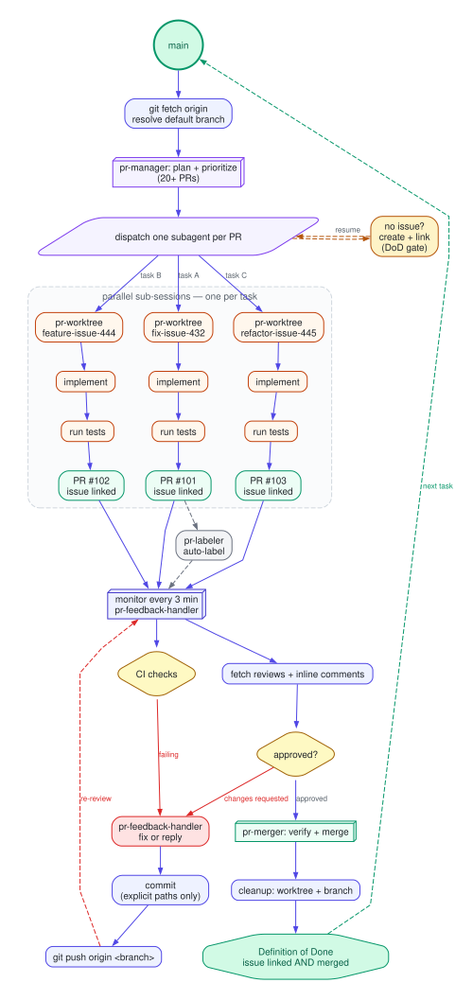

# gh-skills — the autonomous PR brain for AI coding agents

[](LICENSE)
[](skills)
[](https://agentskills.io/specification)
[](https://github.com/odykyi/gh-skills)

**GitHub automation skills for AI coding agents** — the full pull request lifecycle, labelling, projects, and issue-to-PR flow.

Every skill is a self-contained folder with a `SKILL.md` (plus optional `references/` loaded on demand) and follows the standard Anthropic skill format.

---

## Install in one click

<table align="center">
  <tr>
    <td align="center" valign="middle"><a href="claude://code/new?q=Install%20the%20GitHub%20PR%20automation%20skills%20from%20https%3A%2F%2Fgithub.com%2Fodykyi%2Fgh-skills%20into%20this%20project%20and%20walk%20me%20through%20the%20setup%20step%20by%20step."></a></td>
    <td align="center" valign="middle"><a href="cursor://anysphere.cursor-deeplink/prompt?text=Install%20the%20GitHub%20PR%20automation%20skills%20from%20https%3A%2F%2Fgithub.com%2Fodykyi%2Fgh-skills%20into%20this%20project%20and%20walk%20me%20through%20the%20setup%20step%20by%20step."></a></td>
    <td align="center" valign="middle"><a href="codex://new?prompt=Install%20the%20GitHub%20PR%20automation%20skills%20from%20https%3A%2F%2Fgithub.com%2Fodykyi%2Fgh-skills%20into%20this%20project%20and%20walk%20me%20through%20the%20setup%20step%20by%20step."></a></td>
    <td align="center" valign="middle"><a href="https://claude.ai/new?q=Install%20the%20GitHub%20PR%20automation%20skills%20from%20https%3A%2F%2Fgithub.com%2Fodykyi%2Fgh-skills%20into%20this%20project%20and%20walk%20me%20through%20the%20setup%20step%20by%20step."></a></td>
    <td align="center" valign="middle"><a href="https://chatgpt.com/?q=Install%20the%20GitHub%20PR%20automation%20skills%20from%20https%3A%2F%2Fgithub.com%2Fodykyi%2Fgh-skills%20into%20this%20project%20and%20walk%20me%20through%20the%20setup%20step%20by%20step."></a></td>
    <td align="center" valign="middle"><a href="#install"></a></td>
  </tr>
</table>

### Ask an AI about this repo

<table align="center">
  <tr>
    <td align="center" valign="middle"><a href="https://grok.com/?q=Read%20the%20README%20at%20https%3A%2F%2Fgithub.com%2Fodykyi%2Fgh-skills%20and%20explain%20how%20to%20install%20and%20use%20these%20GitHub%20PR%20automation%20skills%20as%20a%20maintainer%20who%20has%20dozens%20of%20open%20pull%20requests."></a></td>
    <td align="center" valign="middle"><a href="https://claude.ai/new?q=Read%20the%20README%20at%20https%3A%2F%2Fgithub.com%2Fodykyi%2Fgh-skills%20and%20explain%20how%20to%20install%20and%20use%20these%20GitHub%20PR%20automation%20skills%20as%20a%20maintainer%20who%20has%20dozens%20of%20open%20pull%20requests."></a></td>
    <td align="center" valign="middle"><a href="https://chatgpt.com/?q=Read%20the%20README%20at%20https%3A%2F%2Fgithub.com%2Fodykyi%2Fgh-skills%20and%20explain%20how%20to%20install%20and%20use%20these%20GitHub%20PR%20automation%20skills%20as%20a%20maintainer%20who%20has%20dozens%20of%20open%20pull%20requests."></a></td>
    <td align="center" valign="middle"><a href="codex://new?prompt=Read%20the%20README%20at%20https%3A%2F%2Fgithub.com%2Fodykyi%2Fgh-skills%20and%20explain%20how%20to%20install%20and%20use%20these%20GitHub%20PR%20automation%20skills%20as%20a%20maintainer%20who%20has%20dozens%20of%20open%20pull%20requests."></a></td>
  </tr>
</table>

---

## This is the autonomous brain for GitHub maintainers

A maintainer with an active repo — think a project like [OpenClaw](https://github.com/odykyi/openclaw) or any fast-moving OSS project — does not have a "write some code" problem. The problem is **the queue**: 30 open PRs, 4 reviewers who never respond, CI that flickers, a branch that drifted, a contributor who left three review comments unanswered, a release branch waiting on two of them.

That queue is a loop, and loops are exactly what agents are good at. `gh-skills` encodes that loop as a set of verifiable procedures:

**Read the queue → open the PR → review it → fix the feedback → merge it → clean up → next.**

Nothing is invented at each step. Every command is a real `gh`/`git` invocation, every gate is a checkable condition, and every destructive action has a guardrail. The agent never force-pushes, never merges with `--admin`, never deletes a branch that isn't merged, and never opens a PR without a linked issue.

Think of it as the PR half of an autonomous maintainer: you give it the repo and the backlog, it keeps the queue moving while you do the thinking only a human can do.

### Who this is for

| | |
|---|---|
| ✅ **Great for** | Maintainers juggling **dozens of PRs** at once |
| ✅ **Great for** | Repos where every PR needs an issue, a label, a review, and a clean merge |
| ✅ **Great for** | Anyone who wants CI to gate merges, and an agent to never let a PR rot |
| ❌ **Not for** | Contributors with **one or two PRs** — just open the PR, this is overkill |
| ❌ **Not for** | Quick one-off edits — the whole point is queue discipline, and you don't have a queue |

If you have **unlimited AI tokens and you like running loops and many subagents**, this is exactly the shape of tool you want: one subagent per PR, each in its own git worktree, all of them reporting back to a single orchestrator that never loses a PR.

If you have a budget of three API calls a day, keep it simple — this repo is for the other kind of day.

---

## The loop

<p align="center">
  
</p>

The flow starts at `main`, fans out into one subagent per task (each in its own worktree), converges on a shared monitoring loop, and cycles back: **changes requested → fix → push → re-review**, and **failing CI → fix → push → re-review**. Only a merged PR closes the loop.

- Source: [`assets/pr-lifecycle.dot`](./assets/pr-lifecycle.dot) (Graphviz)
- Rebuild: `./assets/build-diagram.sh` (needs `graphviz`)

---

## Make your agent genuinely good at GitHub

Without these skills an agent writes code and then guesses at the boring half of the job: it forgets to link the issue, opens a PR with an empty body, misses a reviewer comment, merges with red CI, deletes the wrong branch, and leaves six worktrees behind. Each one of those is a cheap mistake with an expensive follow-up.

With them, the agent stops improvising the workflow and starts running a verified one:

- **Nothing gets opened without an issue.** `pr-opener` enforces the link in both directions, so a PR can never be an orphan.
- **Reviews land where reviewers can act.** `pr-reviewer` and `pr-commenter` post real line-anchored review comments, not wall-of-text top-level comments.
- **Feedback loops close.** `pr-feedback-handler` classifies every incoming comment as *fix* or *reply* and never guesses at an unclear request — it asks instead.
- **Merges are safe by default.** `pr-merger` checks approval, CI, and mergeability before merging, then cleans up the worktree and branch. No `--admin`, no force push, no `-D`.
- **Work is isolated.** `pr-worktree` gives every task its own git worktree, so parallel work never collides and your main checkout is never disturbed.
- **Scale is boring.** `pr-manager` drives 20+ concurrent PRs through parallel subagents with one Definition of Done: issue linked **and** merged.
- **The board stays honest.** `gh-prioritizer` and `gh-project-orchestrator` keep priorities and project state aligned with reality.

In short: these skills turn "the agent touched GitHub" into "the agent ran the workflow correctly" — the same way you'd hand a colleague the runbook instead of a vague instruction.

---

## Skills

| Skill | What it does |
|-------|--------------|
| [pr-workflow-orchestrator](./skills/pr-workflow-orchestrator/SKILL.md) | End-to-end PR workflow: worktree → open → feedback → merge. Never leaves a PR unattended. |
| [pr-manager](./skills/pr-manager/SKILL.md) | Orchestrates 20+ PRs in parallel with strict Definition of Done enforcement. |
| [pr-worktree](./skills/pr-worktree/SKILL.md) | Creates and manages isolated git worktrees for PR work — never touches the main checkout. |
| [pr-opener](./skills/pr-opener/SKILL.md) | Opens PRs with correct formatting, description, and mandatory linked issue. |
| [pr-reviewer](./skills/pr-reviewer/SKILL.md) | Comprehensive code review posted as structured review comments. |
| [pr-feedback-handler](./skills/pr-feedback-handler/SKILL.md) | Handles incoming PR comments — fixes the issue or replies with the reason. |
| [pr-commenter](./skills/pr-commenter/SKILL.md) | Posts PR comments: general, line-level, and thread replies. |
| [pr-labeler](./skills/pr-labeler/SKILL.md) | Auto-labels PRs by branch name, changed files, size, and type. |
| [pr-merger](./skills/pr-merger/SKILL.md) | Merges approved PRs safely — conflicts, CI checks, post-merge cleanup. |
| [gh-pr-review-buttons](./skills/gh-pr-review-buttons/SKILL.md) | Adds "Review this PR in" Grok / Claude / Codex badges to PR descriptions. |
| [gh-project-orchestrator](./skills/gh-project-orchestrator/SKILL.md) | Creates and manages GitHub Projects (v2), linking epics, issues, and PRs. |
| [gh-prioritizer](./skills/gh-prioritizer/SKILL.md) | Auto-sets priorities across project items, audits the board, syncs issue/PR priority. |

---

## Install

```bash
git clone --depth 1 https://github.com/odykyi/gh-skills.git /tmp/gh-skills
cp -R /tmp/gh-skills/skills/* ~/.claude/skills/
```

Or with the skills CLI:

```bash
npx skills add odykyi/gh-skills
```

For Claude Code plugin installs, point the marketplace at this repo — each folder under `skills/` is a valid skill package.

## Prerequisites

- `gh` CLI authenticated (`gh auth status`)
- Repository write access for anything that creates, labels, comments on, or merges PRs

---

## Usage

Skills trigger on intent, e.g.:

- "open a PR for this branch" → `pr-opener`
- "review this PR" → `pr-reviewer`
- "merge the approved PRs" → `pr-merger`
- "manage 20 PRs in parallel" → `pr-manager`
- "set priorities on the project board" → `gh-prioritizer`
- "create a project for this integration" → `gh-project-orchestrator`
- "add AI review buttons to our PRs" → `gh-pr-review-buttons`

### Prompt examples for the main orchestrator

```
@pr-workflow-orchestrator Start task: implement the rate limiter for the
public API (issue #432). Work in a worktree, open a PR linked to issue #432,
watch for reviews, and merge it when CI is green.
```

```
@pr-workflow-orchestrator Handle feedback for PR #277. Read every review and
inline comment, fix what is real, reply to what is not, and merge when the
approval lands.
```

```
@pr-workflow-orchestrator Start tasks:
- task A: add the Stripe webhook endpoint (issue #444) — branch feature/stripe-webhook
- task B: fix the 404 on the settings page (issue #445) — branch fix/settings-404
- task C: split the billing module (issue #446) — branch refactor/billing-split
Run them in parallel, one subagent per task, and report a single merged-PR
summary at the end.
```

```
@pr-workflow-orchestrator Complete delivery for PR #277. Verify approval, CI
and mergeability, merge with the repository's default strategy, then remove the
worktree and the local branch.
```

---

## Notes

- These skills are repository-agnostic. Where a label set, path mapping, or domain taxonomy is involved, the skill ships a documented default that you can align with your own repo conventions.
- Some skills reference companion issue-side skills (`issue-labeler`, `issue-reporter`, `issue-to-pr`). Those are not part of this collection.
- `pr-manager` scales to 20+ concurrent PRs by dispatching parallel subagents (opencode parallel sub-sessions). It has been exercised that way; the per-PR workflow itself is the same one `pr-workflow-orchestrator` runs for a single PR.
- `gh-pr-review-buttons` is derived from [`tdk-landscape/tdk-skills`](https://github.com/tdk-landscape/tdk-skills/tree/main/skills/tdk-pr-review-buttons) (MIT).

## Credits

- `gh-pr-review-buttons` — original by [@tdk-landscape](https://github.com/tdk-landscape) / [tdk-cli-core](https://github.com/tdk-landscape/tdk-cli-core), MIT licensed.
